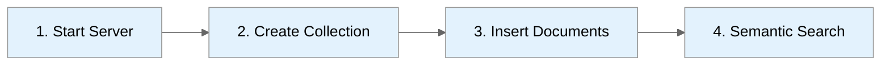

# First Query Tutorial

**Build a semantic search application in 10 minutes**



---

## Scenario: Product Search

We'll build a simple product search that finds similar items using embeddings.

### Prerequisites

- ProximaDB running (see [Installation](./install.md))
- Python 3.11+

---

## Step 1: Install Python SDK

```bash
pip install proximadb
```

---

## Step 2: Start ProximaDB

```bash
# If using platform package
sudo systemctl start proximadb

# If using Docker
docker start proximadb

# If from source
./target/release/proximadb-server --config config/config.toml
```

Verify:
```bash
curl http://localhost:5678/health
```

---

## Step 3: Create Collection

```python
from proximadb_sdk import ProximaDBClient, ProximaRecord, Protocol

# Connect
client = ProximaDBClient(url="http://localhost:5678", protocol=Protocol.REST)

# Create collection for products
client.create_collection(
    name="products",
    dimension=384,  # Sentence transformer dimension
    distance_metric="cosine"
)

print("Created collection: products")
```

---

## Step 4: Insert Products

```python
# Generate embeddings (using sentence-transformers)
from sentence_transformers import SentenceTransformer

encoder = SentenceTransformer('all-MiniLM-L6-v2')

products = [
    {"id": 1, "name": "Wireless Headphones", "price": 79.99, "category": "Electronics"},
    {"id": 2, "name": "USB-C Charging Cable", "price": 12.99, "category": "Electronics"},
    {"id": 3, "name": "Running Shoes", "price": 89.99, "category": "Footwear"},
    {"id": 4, "name": "Coffee Maker", "price": 49.99, "category": "Kitchen"},
    {"id": 5, "name": "Bluetooth Earbuds", "price": 59.99, "category": "Electronics"},
]

# Encode product names
texts = [p["name"] for p in products]
embeddings = encoder.encode(texts)

# Insert ProximaRecords into ProximaDB
records = [
    ProximaRecord(id=str(product["id"]), vector=embedding.tolist(), flexible_fields=product)
    for product, embedding in zip(products, embeddings)
]
client.insert_records("products", records)

print(f"Inserted {len(products)} products")
```

---

## Step 5: Semantic Search

```python
# Search for similar products
query = "audio accessories"
query_embedding = encoder.encode([query])[0]

results = client.search(
    "products",
    vector=query_embedding.tolist(),
    top_k=3,
    # Optional equality filter. Use metadata_filter=, not filter= (TD-SDKERR-1).
    # metadata_filter={"category": "Electronics"},
)

print(f"\nQuery: '{query}'")
print("Top results:")
for i, result in enumerate(results, 1):
    # Over REST, properties come back as {"type": ..., "value": ...} cells today (TD-SDKERR-1).
    print(f"{i}. {result.metadata['name']['value']}")
    print(f"   Score: {result.score:.4f}")
    print(f"   Price: ${result.metadata['price']['value']}")
    print()
```

**Output** (scores and the third result vary with the model version):
```
Query: 'audio accessories'
Top results:
1. Wireless Headphones
   Score: 0.8234
   Price: $79.99

2. Bluetooth Earbuds
   Score: 0.7891
   Price: $59.99

3. USB-C Charging Cable
   Score: 0.6543
   Price: $12.99
```

---

## Step 6: Query with SQL

SQL over the PostgreSQL wire protocol (port 5433) is the product's front door. Today it serves
relational tables (see SQL Interface below). Collections created through REST or the SDK are not
yet queryable from SQL, and vector search inside SQL lands in v0.6 (TD-XMODAL-4, TD-SQLCOLL-1).
See the [PostgreSQL reference](../03-api-reference/postgres.adoc) for what is supported.

---

## Complete Example

Run this against a fresh server (it creates `products`).

```python
from proximadb_sdk import ProximaDBClient, ProximaRecord, Protocol
from sentence_transformers import SentenceTransformer

# Setup
client = ProximaDBClient(url="http://localhost:5678", protocol=Protocol.REST)
encoder = SentenceTransformer('all-MiniLM-L6-v2')

# Create collection
client.create_collection("products", dimension=384, distance_metric="cosine")

# Sample data
products = [
    {"id": 1, "name": "Wireless Headphones", "price": 79.99},
    {"id": 2, "name": "Running Shoes", "price": 89.99},
    {"id": 3, "name": "Coffee Maker", "price": 49.99},
]

# Insert
texts = [p["name"] for p in products]
embeddings = encoder.encode(texts)
client.insert_records("products", [
    ProximaRecord(id=str(product["id"]), vector=embedding.tolist(), flexible_fields=product)
    for product, embedding in zip(products, embeddings)
])

# Search
query = "audio equipment"
query_emb = encoder.encode([query])[0]
results = client.search("products", vector=query_emb.tolist(), top_k=2)

for r in results:
    print(f"{r.metadata['name']['value']}: ${r.metadata['price']['value']} (score: {r.score:.3f})")
```

---

## REST API Version

Run this against a fresh server (it creates `products`).

```bash
# Create collection
curl -X POST http://localhost:5678/api/v2/collections \
  -H "Content-Type: application/json" \
  -d '{
    "name": "products",
    "dimension": 3,
    "distance_metric": "cosine",
    "engine": "sst",
    "enable_proxima_record": true
  }'

# Insert records (3-dimensional toy vectors; use your model's dimension in practice)
curl -X POST http://localhost:5678/api/v2/collections/products/records/batch \
  -H "Content-Type: application/json" \
  -d '{
    "records": [
      {"id": "1", "vector": [0.1, 0.2, 0.3], "props": {"name": "Headphones", "price": 79.99}},
      {"id": "2", "vector": [0.3, 0.4, 0.5], "props": {"name": "Shoes", "price": 89.99}}
    ]
  }'

# Search
curl -X POST http://localhost:5678/api/v2/collections/products/search \
  -H "Content-Type: application/json" \
  -d '{
    "vector": [0.1, 0.2, 0.3],
    "top_k": 5,
    "include_metadata": true
  }'
```

---

## SQL Interface

> **Connecting on 5433?** pgwire binds `127.0.0.1:5433` unless the listener enforces its
> own per-connection authentication (pgwire SCRAM, `TD-PGWIRE-AUTH-1`). So `localhost:5433`
> works against a locally-run `proximadb-server`, but **not** through a port published from
> a container — there, reach it from inside the container's network namespace, or enable
> SCRAM and then set `[api] pg_port`. See `TD-PGWIRE-CONTAINER-1`.

```sql
-- Connect (from a locally run server, or inside the container's network namespace)
-- psql -h 127.0.0.1 -p 5433 -U postgres -d proximadb

CREATE TABLE menu_items (id INT PRIMARY KEY, name TEXT, price NUMERIC);

INSERT INTO menu_items (id, name, price)
VALUES (1, 'Wireless Headphones', 79.99), (2, 'Coffee Maker', 49.99);

SELECT name, price FROM menu_items WHERE price < 60 ORDER BY price;
```

`ORDER BY embedding <-> '<literal>'::vector LIMIT k` over collections created through REST or the
SDK is Beta. `VECTOR(n)` columns created over pgwire work today only in tables that also have a JSON or JSONB column
(TD-SQLCOLL-1).

---

## Next Steps

- [Vector Search Guide](../02-guides/vector-search.md) - Advanced filtering, hybrid search
- [Graph API](../03-api-reference/graph.adoc) - Add relationships to your data
- [Multi-Model Joins](../02-guides/multi-model-joins.md) - Combine vectors, documents, graphs
- [API Reference](../03-api-reference/index.md) - Complete API documentation

---

## Common Issues

**Connection refused:**
```bash
# Check if server is running
curl http://localhost:5678/health
```

**Dimension mismatch:**
```python
# Ensure embedding dimension matches collection dimension
print(f"Model dimension: {len(encoder.encode('test'))}")
print(f"Collection dimension: {client.get_collection('products').dimension}")
```

**Import error:**
```bash
# Install sentence-transformers
pip install sentence-transformers
```

---

*Need help?* [GitHub Issues](https://github.com/anvai-labs/proximaDB/issues)
