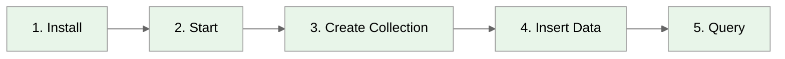

# Quick Start

**Get ProximaDB running in 5 minutes**



---

## Choose Your Installation Method

| Method | OS | Time | Best For |
|--------|-------|------|----------|
| [Platform Package](./install.md#platform-packages) | Linux, Windows | 2 min | Servers (see the known issues in the guide) |
| [Docker](./install.md#docker) | Any | 1 min | Testing, dev |
| [From Source](./install.md#from-source) | Any | 10 min | Development |

---

## Quick Test (Docker)

```bash
# 1. Run ProximaDB (a throwaway trial: this container keeps its data inside itself, TD-PKG-3;
#    for data that survives the container, follow the Docker section of the installation guide)
docker run -d -p 5678:5678 --name proximadb-trial vjsingh1984/proximadb:latest

# 2. Wait for startup (5 seconds)
sleep 5

# 3. Verify it's running
curl http://localhost:5678/health
# {"status":"healthy","version":"<installed release>"}
```

That's the whole smoke test. To go further — create a collection, insert records and run your
first search — follow the [First Query tutorial](./first-query.md). It carries the canonical
walkthrough in three forms: raw REST (`curl`), the Python SDK, and SQL over pgwire.

---

## Python SDK

The Python SDK (`pip install proximadb`) speaks the same REST API — connect, create a
collection, insert `ProximaRecord`s with embeddings, search — in a few lines. The
[First Query tutorial](./first-query.md) builds a complete semantic-search example with it,
from collection creation to filtered search.

---

## SQL Interface

ProximaDB also speaks SQL over the PostgreSQL wire protocol (port 5433): `CREATE TABLE`,
`INSERT`, `SELECT` with standard ANSI semantics. The canonical quick example — plus the
pgwire listener's loopback-binding caveat (`TD-PGWIRE-AUTH-1`, `TD-PGWIRE-CONTAINER-1`) —
lives in the [First Query tutorial's SQL section](./first-query.md#sql-interface).

---

## What's Next?

- **Learn installation options**: [Installation Guide](./install.md)
- **Build your first app**: [First Query Tutorial](./first-query.md)
- **Understand the architecture**: [Architecture Basics](./architecture-basics.md)
- **Explore features**: [Guides](../02-guides/index.md)

---

## Troubleshooting

**Port already in use?**
```bash
# Find what's using port 5678
lsof -i :5678

# Kill the process
kill -9 <PID>
```

**Server won't start?**
```bash
# Check logs
sudo journalctl -u proximadb -f  # Linux
docker logs proximadb-trial        # Docker (quick test)
```

**Can't connect?**
```bash
# Verify server is running
curl http://localhost:5678/health

# Check firewall
sudo firewall-cmd --list-ports  # Linux
```

---

*Need help?* [GitHub Issues](https://github.com/anvai-labs/proximaDB/issues)
