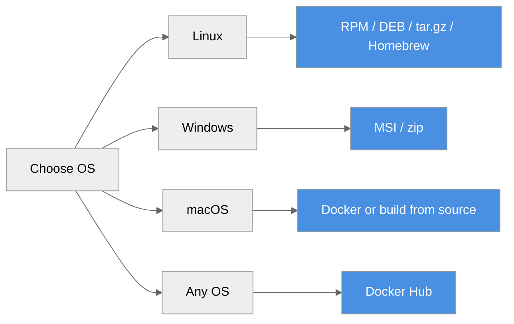

# Installation Guide

**Install ProximaDB on your platform**



Every release is published on
[GitHub Releases](https://github.com/anvai-labs/proximaDB/releases) with RPM, DEB and MSI
packages, Linux x86_64 and Windows x86_64 archives, and checksums; the server image is
`vjsingh1984/proximadb` on Docker Hub, and the `anvai-labs/tap` Homebrew tap installs the Linux
x86_64 archive. There is no native macOS package yet: on macOS use Docker or build from source.

The snippets below resolve the latest release instead of hard-coding a version:

```bash
VERSION=$(curl -fsSL https://api.github.com/repos/anvai-labs/proximaDB/releases/latest \
  | sed -n 's/.*"tag_name": *"v\([^"]*\)".*/\1/p')
echo "Installing ProximaDB $VERSION"
BASE=https://github.com/anvai-labs/proximaDB/releases/download/v$VERSION
```

---

## Platform Packages

### Linux requirements (archive, .deb, .rpm, Homebrew)

The Linux x86_64 binaries are built against **glibc 2.28** with **OpenSSL
statically linked**, so they need no system OpenSSL. Each package is installed
and the server binary is started and health-checked on these distributions for every release
(`release-smoke.yml`, `packages` job; the smoke runs the binary directly, not the systemd
service):

| Package | Minimum (verified) |
|---|---|
| `.rpm` | RHEL / Rocky / Alma **8** and 9, Fedora 41 |
| `.deb` | **Debian 11** and 12, **Ubuntu 20.04**, 22.04, 24.04 |

Older releases differ: **v0.4.1 and earlier** were built on Ubuntu 22.04 and
need glibc 2.35 and `libssl.so.3` -- their `.el8.rpm` does **not** run on
RHEL/Rocky 8 or 9, and their `.deb` needs Ubuntu 22.04+ / Debian 12+.

> **Known issue (TD-PKG-1, fix scheduled for v0.5):** as shipped, the RPM/DEB service does not start
> (the unit waits for a readiness signal the server never sends, the state directories are
> root-owned, and the server's `./log` directory resolves to `/`), and the packaged config keeps all
> data under `/tmp`, which the unit wipes on restart. Until it is fixed, apply this after installing:
>
> ```bash
> sudo sed -i 's#/tmp/proximadb#/var/lib/proximadb#g' /etc/proximadb/config.toml
> sudo chown -R proximadb:proximadb /var/lib/proximadb /var/log/proximadb
> sudo mkdir -p /etc/systemd/system/proximadb.service.d
> printf '[Service]\nType=simple\nWorkingDirectory=/var/lib/proximadb\n' \
>   | sudo tee /etc/systemd/system/proximadb.service.d/override.conf
> sudo systemctl daemon-reload
> sudo systemctl reset-failed proximadb; sudo systemctl enable --now proximadb
> ```
>
> Verified against the v0.4.1 `.deb` by running the server as the `proximadb` user with the same
> config and working directory (write, restart, read back); not yet run under systemd itself. Logs
> go to the journal and `/var/lib/proximadb/log/`. After an RPM upgrade (`rpm -Uvh`), re-apply
> the workaround: the RPM may replace the edited config. Or use the [Linux archive](#linux-archive-any-distribution) or
> [Docker](#docker).

### Linux (RPM - RHEL/Rocky/Alma 8+, Fedora)

```bash
wget "$BASE/proximadb-$VERSION-1.el8.x86_64.rpm"
sudo rpm -ivh "proximadb-$VERSION-1.el8.x86_64.rpm"

sudo systemctl enable --now proximadb
curl http://localhost:5678/health
```

**What gets installed:**
- Binaries: `/usr/bin/` (proximadb-server, proximadb-bench, proximadb-migrate)
- Config: `/etc/proximadb/config.toml`
- Service: `/usr/lib/systemd/system/proximadb.service`
- Data: `/var/lib/proximadb/` (after the TD-PKG-1 workaround above; the shipped config uses `/tmp`)
- Logs: `/var/log/proximadb/`

### Linux (DEB - Debian 11+, Ubuntu 20.04+)

```bash
wget "$BASE/proximadb_${VERSION}_amd64.deb"
sudo dpkg -i "proximadb_${VERSION}_amd64.deb"

sudo systemctl enable --now proximadb
curl http://localhost:5678/health
```

### Linux (archive, any distribution)

```bash
wget "$BASE/proximadb-$VERSION-x86_64-unknown-linux-gnu.tar.gz"
wget "$BASE/proximadb-$VERSION-x86_64-unknown-linux-gnu.tar.gz.sha256"
sha256sum -c "proximadb-$VERSION-x86_64-unknown-linux-gnu.tar.gz.sha256"
tar xzf "proximadb-$VERSION-x86_64-unknown-linux-gnu.tar.gz"
cd "proximadb-$VERSION-x86_64-unknown-linux-gnu"
# The shipped config keeps every root under /tmp; move them somewhere durable first:
sed -i 's#/tmp/proximadb#'"$HOME"'/proximadb-data#g' config/config.toml
./proximadb-server --config config/config.toml
```

### Windows (MSI)

```powershell
# Download proximadb-<version>-x64.msi from GitHub Releases, then:
msiexec /i proximadb-<version>-x64.msi

# The MSI installs no Windows service yet (TD-PKG-2). From an elevated shell, edit
# C:\Program Files\ProximaDB\config.toml so every /tmp/proximadb root points at a durable folder
# (not yet verified on Windows), for example:
#   data_dir     = "C:/ProgramData/ProximaDBData/data"
#   metadata_url = "file:///C:/ProgramData/ProximaDBData/metadata"
#   (and the same for storage_locations, global_manifest_url and the audit directory)
# Then run the server from a writable directory (it creates .\log there):
cd $env:LOCALAPPDATA
& "C:\Program Files\ProximaDB\proximadb-server.exe" --config "C:\Program Files\ProximaDB\config.toml"
```

**What gets installed:**
- Binaries and config: `C:\Program Files\ProximaDB\` (`config.toml` sits next to the binaries)
- An empty `C:\ProgramData\ProximaDBData\`, which the shipped config does not use until you point
  its roots there (TD-PKG-2)

### Linux x86_64 (Homebrew)

The release publishes a prebuilt server archive for **Linux x86_64 only**, and
the Homebrew formula in the `anvai-labs/tap` tap installs exactly that archive.
There is no macOS binary or formula: on macOS use Docker or build from source
(below).

```bash
brew install anvai-labs/tap/proximadb

# Example configs are in $(brew --prefix)/share/proximadb/config; copy one and move its storage
# roots off /tmp first (TD-PKG-1), e.g.
#   sed 's#/tmp/proximadb#'"$HOME"'/proximadb-data#g' <example>.toml > proximadb.toml
proximadb-server --config proximadb.toml

# Verify
curl http://localhost:5678/health
```

---

## Docker

### Docker Hub

> **Known issue (TD-PKG-3, fix scheduled for v0.5):** the image's built-in config keeps every
> storage root under `/tmp/proximadb` inside the container, so data does not survive `docker rm`
> even with a volume mounted. Until it is fixed, run it with a config that points the roots at the
> image's volume (verified: a record written before `docker rm` is readable from a new container on
> the same volume):

```bash
# One-time: copy the image's config with every root moved to the volume
docker run --rm --entrypoint cat vjsingh1984/proximadb:latest /config/config.toml \
  | sed 's#/tmp/proximadb#/data/proximadb#g' > proximadb.toml

docker run -d \
  --name proximadb \
  -p 5678:5678 \
  -v proximadb-data:/data/proximadb \
  -v "$PWD/proximadb.toml:/config/config.toml:ro" \
  vjsingh1984/proximadb:latest        # or a pinned tag, e.g. vjsingh1984/proximadb:<version>

docker logs -f proximadb
curl http://localhost:5678/health
```

> **5433 (pgwire) is intentionally not published.** pgwire runs in the image, but on
> `127.0.0.1:5433` inside the container, so `-p 5433:5433` would publish a port that
> accepts no connections. Use it from a locally-run binary, or from a client sharing the
> container's network namespace:
>
> ```bash
> docker run --rm -it --network container:proximadb postgres:16 \
>   psql -h 127.0.0.1 -p 5433 -U postgres -d proximadb
> ```
>
> Serving it from the host needs pgwire SCRAM (`TD-PGWIRE-AUTH-1`) *before* `[api]
> pg_port` — setting `pg_port` alone makes the server fail closed at boot. Making the published
> image reachable over pgwire is roadmap v0.5 (`TD-PGWIRE-CONTAINER-1`). Details:
> `deploy/README.md`.

### Docker Compose

```yaml
# docker-compose.yml
services:
  proximadb:
    image: vjsingh1984/proximadb:latest
    ports:
      - "5678:5678"  # Unified API
      # 5433 (pgwire) omitted on purpose — loopback-only in the container; see above.
    volumes:
      - proximadb-data:/data/proximadb             # the image's data directory
      - ./proximadb.toml:/config/config.toml:ro    # roots moved to /data/proximadb (see above)
    environment:
      - RUST_LOG=info
    restart: unless-stopped

volumes:
  proximadb-data:
```

```bash
docker compose up -d
```

---

## From Source

### Prerequisites

- Rust: the repository pins its toolchain in `rust-toolchain.toml`; `rustup` installs it
  automatically on first build.
- OpenSSL development libraries and `pkg-config`
- Python 3.11+ (for the Python SDK)

### Linux

```bash
sudo apt-get update
sudo apt-get install -y pkg-config libssl-dev build-essential

git clone https://github.com/anvai-labs/proximaDB.git
cd proximaDB
cargo build --release --bin proximadb-server
./target/release/proximadb-server --config config/config.toml
```

### macOS

```bash
brew install openssl@3 pkg-config

git clone https://github.com/anvai-labs/proximaDB.git
cd proximaDB
export OPENSSL_DIR=$(brew --prefix openssl@3)
export PKG_CONFIG_PATH=$(brew --prefix openssl@3)/lib/pkgconfig
cargo build --release --bin proximadb-server
./target/release/proximadb-server --config config/config.toml
```

### Windows

```powershell
# Install Rust from https://rustup.rs/ and the Visual Studio Build Tools, then:
git clone https://github.com/anvai-labs/proximaDB.git
cd proximaDB
cargo build --release --bin proximadb-server
.\target\release\proximadb-server.exe --config config\config.toml
```

---

## Configuration

### Default Configuration

The default config file is installed at:
- **Linux packages**: `/etc/proximadb/config.toml`
- **Windows**: `C:\Program Files\ProximaDB\config.toml`
- **From source**: `config/config.toml` in the repository

### Default Ports

| Port | Protocol | Purpose |
|------|----------|---------|
| **5678** | HTTP/2 | Unified REST + gRPC (+ Arrow Flight; Flight vector search is supported, Flight as a general customer transport is experimental) |
| **5433** | PostgreSQL | SQL wire protocol. Binds `127.0.0.1` unless the listener authenticates (pgwire SCRAM, `TD-PGWIRE-AUTH-1`), so in a container it is not reachable through a published port. |

### Minimal Config

```toml
[server]
port = 5678

[api]
unified_mode = true  # Single port for REST, gRPC and Arrow Flight
```

Pass `"engine": "sst"` when you create a collection: a vector collection created without `engine` (and without an index or quantization) is auto-routed to HELIX, which is Beta. See the
[storage engine guide](../05-concepts/storage-engines.adoc) before choosing another engine.

---

## Verification

### Health Check

```bash
curl http://localhost:5678/health
```

**Response** (the `version` field is the installed release):
```json
{
  "status": "healthy",
  "version": "X.Y.Z",
  "uptime_seconds": 123.45
}
```

### Test Collection

A healthy `/health` response is the install's own verification. As a last check you can list
the (empty) collection set:

```bash
curl http://localhost:5678/api/v2/collections
```

Creating a collection and running your first insert and search is the
[First Query tutorial](./first-query.md)'s job — it is the canonical walkthrough (REST, Python
SDK and SQL variants), kept in one place so the steps cannot drift apart between guides.

---

## Upgrade

### Platform Packages

Resolve `VERSION` and `BASE` as above, download the new package, then:

```bash
sudo rpm -Uvh "proximadb-$VERSION-1.el8.x86_64.rpm" && sudo systemctl restart proximadb   # RPM
sudo dpkg -i "proximadb_${VERSION}_amd64.deb" && sudo systemctl restart proximadb          # DEB
```

On Windows, run the new MSI; it upgrades the binaries in place.

### Docker

> **Upgrading a container started without the config mount?** Its data lives only inside the
> container (TD-PKG-3): do **not** `docker rm` it. Rescue it first and keep it at its original path
> (the catalog stores absolute `/tmp/proximadb` paths, so copying the files into `/data/proximadb`
> does not work). Verified with the 0.4.1 image: a record written before the rescue reads back:
>
> ```bash
> docker stop proximadb
> rm -rf ./proximadb-rescue   # docker cp nests the files if the target already exists
> docker cp proximadb:/tmp/proximadb ./proximadb-rescue
> docker volume create proximadb-legacy
> docker run --rm -v proximadb-legacy:/dst -v "$PWD/proximadb-rescue:/src:ro" alpine \
>   sh -c 'cp -a /src/. /dst/ && chown -R 999:999 /dst'
> docker run -d --name proximadb-legacy -p 5678:5678 -v proximadb-legacy:/tmp/proximadb \
>   "$(docker inspect -f '{{.Image}}' proximadb)"   # the exact image the old container ran
> ```

The rescued container must keep `-v proximadb-legacy:/tmp/proximadb` (and the built-in config) on
every later upgrade; the steps below would start it empty. Moving it onto the `/data/proximadb`
layout needs the migration tracked in TD-PKG-3.

For a container started with the config mount above:

```bash
docker pull vjsingh1984/proximadb:latest
docker stop proximadb && docker rm proximadb
# Re-run with the same -v proximadb-data:/data/proximadb and config mount as above.
# Without the config mount the data was never on the volume (TD-PKG-3).
docker run -d ... vjsingh1984/proximadb:latest
```

### From Source

```bash
git pull origin main
cargo build --release --bin proximadb-server
```

---

## Uninstall

### Linux (RPM)

```bash
sudo systemctl disable --now proximadb
sudo rpm -e proximadb
sudo rm -rf /var/lib/proximadb
```

### Linux (DEB)

```bash
sudo systemctl disable --now proximadb
sudo dpkg -r proximadb
sudo rm -rf /var/lib/proximadb
```

### Windows

```powershell
# Stop the server process, then
# uninstall "ProximaDB" from Settings → Apps, or: msiexec /x proximadb-<version>-x64.msi
```

### Homebrew (Linux x86_64)

```bash
brew uninstall anvai-labs/tap/proximadb
# Data lives wherever your config's data_dir / storage urls point; remove it separately.
```

---

## Next Steps

- [Quick Start](./index.md) - 5-minute overview
- [First Query](./first-query.md) - Tutorial
- [Configuration](../03-api-reference/configuration.adoc) - Full config reference
- [Deployment](../04-operations/deployment.adoc) - Production setup

---

*Need help?* [GitHub Issues](https://github.com/anvai-labs/proximaDB/issues)
