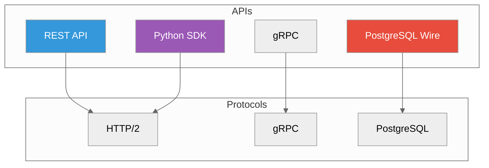

# API Reference

**Complete API documentation**



> **New here?** Start with the **[Client Surface Map](./client-surface-map.adoc)** —
> a one-page orientation to every surface, its payload/response shape, and how the
> SDK + pgwire lower to the engine. Then dive into the per-surface reference below.

---

## REST API

**Base URL**: `http://localhost:5678`

Canonical REST writes and reads use record/table endpoints under `/api/v2`.
The older `/api/v1/*` routes remain available only as deprecated compatibility
facades and emit deprecation metadata.

| Endpoint | Method | Description |
|----------|--------|-------------|
| `/api/v2/collections` | POST | Create collection/table with typed schema |
| `/api/v2/collections/{id}/records/batch` | POST | Insert or upsert ProximaRecords |
| `/api/v2/collections/{id}/records/{record}` | GET | Get ProximaRecord |
| `/api/v2/collections/{id}/records/{record}` | DELETE | Delete ProximaRecord |
| `/api/v2/collections/{id}/search` | POST | Record/vector search |
| `/api/v2/query` | POST | Shared query facade |
| `/api/v1/*` | Various | Deprecated compatibility facades |
| `/health` | GET | Health check |

### Example: Create Collection

```bash
curl -X POST http://localhost:5678/api/v2/collections \
  -H "Content-Type: application/json" \
  -d '{
    "name": "products",
    "dimension": 384,
    "metric": "cosine",
    "engine": "sst"
  }'
```

### Example: Search

```bash
curl -X POST http://localhost:5678/api/v2/collections/products/search \
  -H "Content-Type: application/json" \
  -d '{
    "vector": [0.1, 0.2, ...],
    "k": 10,
    "filter": {"category": "Electronics"}
  }'
```

**Full docs**: [REST API Reference](./rest.adoc)

---

## gRPC API

**Default port**: `5678` (via HTTP/2)

Services:
- `proximadb.v2.ProximaRecordService` - Canonical record writes/search/schema operations
- `proximadb.v1.*` - Deprecated compatibility services for existing clients

### Example (Python)

```python
import grpc
from proximadb.v2 import record_pb2, record_pb2_grpc

channel = grpc.insecure_channel('localhost:5678')
stub = record_pb2_grpc.ProximaRecordServiceStub(channel)

# Use InsertRecords/SearchRecords for canonical record APIs.
```

**Full docs**: gRPC API details are generated from `proto/`.

---

## PostgreSQL Wire Protocol

**Port**: `5433`, bound to `127.0.0.1`

Connect using any PostgreSQL client:

```bash
psql -h localhost -p 5433 -U postgres
```

> **Loopback only unless the listener authenticates.** Under the trust auth default the
> boot-time listener preflight admits pgwire on loopback only, so the command above works
> against a locally-run server but **not** through a port published from a container
> (there pgwire is on the container's own `127.0.0.1:5433`). Serving it off loopback
> requires pgwire SCRAM (`TD-PGWIRE-AUTH-1`) *and then* `[api] pg_port`; `pg_port` alone
> makes the server fail closed at boot. See `TD-PGWIRE-CONTAINER-1`.

### SQL Extensions

```sql
-- Beta: nearest neighbours of a collection created through REST or the SDK
SELECT * FROM products
ORDER BY embedding <-> '[0.1, 0.2, 0.3]'::vector
LIMIT 10;
```

Only this `ORDER BY embedding <-> '<literal>'::vector LIMIT k` form works today. Projecting the
distance as a column returns a wrong result (TD-PGVEC-1); the `vector_search()` table function
over pgwire and `VECTOR(n)` columns created over pgwire do not work yet (TD-XMODAL-4,
TD-SQLCOLL-1).

**Full docs**: SQL and PostgreSQL wire coverage is tracked in [Supported Surface](../SUPPORTED_SURFACE.adoc).

---

## Python SDK

```bash
pip install proximadb
```

### Quick Start

```python
from proximadb import ProximaDB

# Connect
client = ProximaDB("http://localhost:5678")

# Create collection
collection = client.create_collection(
    name="products",
    dimension=384,
    metric="cosine"
)

# Insert
collection.insert(
    vectors=[[0.1, ...], [0.2, ...]],
    ids=[1, 2],
    metadata=[{"name": "A"}, {"name": "B"}]
)

# Search
results = collection.search(
    query_vector=[0.1, ...],
    k=10
)
```

**Full docs**: [Python SDK Guide](../02-guides/sdk-python-guide.adoc)

---

## Configuration API

### Environment Variables

| Variable | Default | Description |
|----------|---------|-------------|
| `PROXIMADB_PORT` | — | Not read by the server; set `[server] port` in `config.toml` |
| `PROXIMADB_DATA_DIR` | — | Not read by the config loader; set `data_dir` and the other storage roots in `config.toml` (TD-PKG-3) |
| `RUST_LOG` | `info` | Log level |
| `PROXIMADB_ENGINE` | — | Not read by the server; choose the engine per collection (TD-ENGSEL-1) |

### Config File

```toml
[server]
port = 5678
host = "0.0.0.0"

[storage]
# The vector engine is chosen per collection at create time (pass "engine": "sst"); there is no server-wide key.
data_dir = "/var/lib/proximadb"

[api]
unified_mode = true
# Real key names are `enable_pgwire` / `pg_port` (the earlier
# `enable_postgres_wire` / `postgres_port` spellings here were not read by the
# server). pgwire is enabled by default; `pg_port` is deliberately left UNSET in
# the shipped config because setting it re-derives the pgwire bind from
# `[server] bind_address`, and a non-loopback trust-mode pgwire listener is
# refused at boot. Set it only alongside pgwire SCRAM (TD-PGWIRE-AUTH-1).
enable_pgwire = true
# pg_port = 5433

[monitoring]
metrics_enabled = true
prometheus_port = 9090
```

**Full docs**: [Configuration Reference](./configuration.adoc)

---

## Response Formats

### Success Response

```json
{
  "status": "success",
  "data": { ... }
}
```

### Error Response

```json
{
  "status": "error",
  "error": {
    "code": "INVALID_COLLECTION",
    "message": "Collection not found"
  }
}
```

### Health Check

```json
{
  "status": "healthy",
  "version": "X.Y.Z",
  "uptime_seconds": 1234.56
}
```

---

## Rate Limiting

| Tier | Requests/sec | Burst |
|------|--------------|-------|
| Default | 100 | 200 |
| Pro | 1000 | 2000 |

Headers:
```
X-RateLimit-Limit: 100
X-RateLimit-Remaining: 95
X-RateLimit-Reset: 1640000000
```

---

## Authentication

```bash
# Bearer token
curl -H "Authorization: Bearer $TOKEN" \
  http://localhost:5678/api/v2/collections
```

```python
# Python SDK
client = ProximaDB(
    "http://localhost:5678",
    api_key="your-api-key"
)
```

---

## Next Steps

- [REST API](./rest.adoc) - Complete REST reference
- [Python SDK](../02-guides/sdk-python-guide.adoc) - Python client guide
- [Configuration](./configuration.adoc) - All config options

---

*Need help?* [GitHub Issues](https://github.com/anvai-labs/proximaDB/issues)
