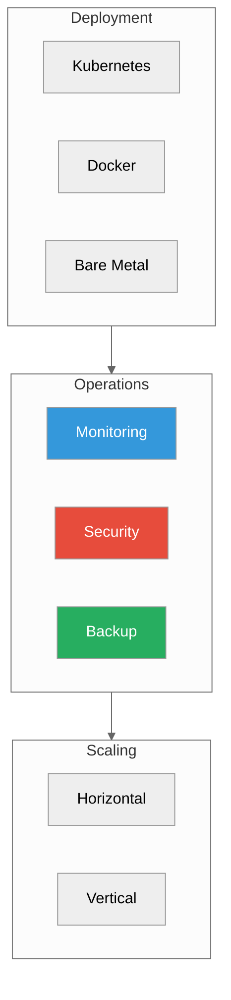

# Operations

**Running ProximaDB in production**

Operational examples that still use `/api/v1/admin/*` are compatibility
endpoints and emit deprecation metadata. Prefer canonical control-plane APIs as
they are promoted.



---

## Deployment

| Platform | Guide | Complexity |
|----------|-------|------------|
| **Kubernetes** | [Deployment Guide](./deployment.adoc) | Medium |
| **Docker Compose** | [Docker Guide](./deployment.adoc#docker) | Low |
| **Platform Packages** | [Platform Packages](../02-guides/platform-packages.md) | Low |
| **Bare Metal** | [Bare Metal](./deployment.adoc#bare-metal) | Medium |

### Quick Start (Docker)

```yaml
# docker-compose.yml
version: '3.8'
services:
  proximadb:
    image: vjsingh1984/proximadb:latest
    ports:
      - "5678:5678"
      # 5433 (pgwire) is deliberately NOT published: the shipped config leaves
      # `[api] pg_port` unset, so pgwire listens on 127.0.0.1:5433 inside the
      # container and a published 5433 accepts no connections. See
      # "PostgreSQL wire protocol" in deploy/README.md and
      # TD-PGWIRE-CONTAINER-1 for the SCRAM prerequisite to changing that.
    volumes:
      - proximadb-data:/var/lib/proximadb
    environment:
      - RUST_LOG=info
    restart: unless-stopped
    deploy:
      resources:
        limits:
          memory: 4G
        reservations:
          memory: 2G

volumes:
  proximadb-data:
```

---

## Monitoring

### Health Check

```bash
curl http://localhost:5678/health
```

**Response:**
```json
{
  "status": "healthy",
  "version": "0.2.0",
  "uptime_seconds": 123456,
  "collections": 10,
  "total_vectors": 1000000
}
```

### Metrics Endpoint

```bash
curl http://localhost:5678/metrics
```

**Key Metrics:**
```
# Request latency
proximadb_request_duration_seconds{endpoint="search"}

# Throughput
proximadb_requests_total{method="POST"}

# Storage
proximadb_storage_bytes{engine="sst"}

# Cache hit rate
proximadb_cache_hit_ratio
```

### Prometheus + Grafana

```yaml
# prometheus.yml
scrape_configs:
  - job_name: 'proximadb'
    static_configs:
      - targets: ['proximadb:5678']
    metrics_path: '/metrics'
```

Import Grafana dashboard from `deploy/grafana/`.

### Log Monitoring

```bash
# Systemd
sudo journalctl -u proximadb -f

# Docker
docker logs -f proximadb

# Kubernetes
kubectl logs -f deployment/proximadb
```

---

## Security

### Authentication

```toml
# config.toml
[security]
enabled = true
method = "bearer_token"
jwt_secret = "your-secret-key"

# API keys
[security.api_keys]
admin = "admin-key-hash"
readonly = "readonly-key-hash"
```

### TLS/SSL

```toml
[security.tls]
enabled = true
cert_file = "/etc/proximadb/certs/server.crt"
key_file = "/etc/proximadb/certs/server.key"
ca_file = "/etc/proximadb/certs/ca.crt"
```

```bash
# With TLS
curl -k https://localhost:5678/health
```

### Network Security

```bash
# Firewall (Linux)
sudo firewall-cmd --add-port=5678/tcp --permanent
sudo firewall-cmd --reload

# Only open 5433 (pgwire) for a deployment that actually serves it off loopback,
# which requires pgwire SCRAM (TD-PGWIRE-AUTH-1) plus `[api] pg_port`. In the
# default container pgwire binds 127.0.0.1:5433, so an open 5433 reaches nothing;
# with SCRAM off, moving it to 0.0.0.0 is refused at boot, not exposed.
# sudo firewall-cmd --add-port=5433/tcp --permanent

# Only allow local connections
sudo firewall-cmd --add-rich-rule='rule family="ipv4" source address="127.0.0.1" port protocol="tcp" port="5678" accept'
```

### RBAC

```toml
[security.rbac]
enabled = true

[[security.rbac.roles]]
name = "admin"
permissions = ["read", "write", "delete", "admin"]

[[security.rbac.roles]]
name = "readonly"
permissions = ["read"]
```

---

## Backup & Restore

ProximaDB has two different protections, and they cover different failures:

- **Node or disk loss when data is in object storage.** When collections and the catalog live in object storage (`adls://`, `s3://`, `gs://`), losing a node's local disks loses nothing durable. A fresh server reattaches and recovers. CI checks this with the SIGKILL restart suite (`object_store_restart_recovery`).
- **Local-disk deployments, or a point-in-time copy.** Use the offline cold backup below.

### Cold backup (server stopped)

```bash
# 1. Stop the server. Backup takes the server's own storage-ownership lease,
#    so it REFUSES while a server is running. It never takes a torn copy.
sudo systemctl stop proximadb

# 2. Back up every local storage root the configuration names.
#    Run from the server's working directory: relative paths resolve against it.
proximadb-server -c /etc/proximadb/config.toml backup --to /backup/proximadb-$(date +%Y%m%d)

sudo systemctl start proximadb
```

What a backup contains:

- **Every local root**: `data_dir`, metadata, storage locations, WAL, SST/VIPER data. Files are copied byte for byte and SHA-256 checksummed.
- **`manifest.json`, written last and atomically.** A directory without a manifest is an incomplete backup, and restore refuses it.
- **Not included:**
  - object-storage roots: they are listed as *uncovered* and a warning is printed;
  - the warm-tier disk cache: it is rebuildable, and restore leaves it empty;
  - lock and runtime-state files.
- **Backup refuses rather than silently omit durable state outside the storage roots.**
  - At boot, the server records where it writes durable state, resolved from *its own* environment and configuration: `<data_dir>/.proximadb-durable-locations.json`.
  - Backup checks that record and its own environment, and refuses if any local location lies outside every storage root. The locations covered are a `[queue]` root, `PROXIMADB_QUEUE_ROOT`, `PROXIMADB_WAL_LOCAL_DIR`, a local `global_manifest_url`, `PROXIMADB_CORPUS_VERSION_PATH`, the io_trace spool, and the `rl_planner` log path.
  - Because the server records its own view, per-pod environment variables (Kubernetes or systemd `Environment=`) are honoured even when you run `backup` from a plain shell.
  - A data directory without the record (one never served by this version) is refused. Start the server once, then stop it, then back up.
- **The shipped `config/config.toml` sets `global_manifest_url = file:///tmp/proximadb/manifest`.** That path is outside every storage root, so backup refuses with this config. Remove the key, or point it inside a storage root (for example under the WAL directory), before relying on cold backup.
- **WAL directories are always included,** including a separate `wal_local_dir`, regardless of `enable_wal`. A backup taken after a crash is crash-consistent, and the WAL replays on restore.
- **Known limitation for a separate local WAL disk (TD-WAL-5).**
  - A *config-file* `wal_local_dir` is backed up, but the engine currently does **not** replay it after a crash: acknowledged-but-unflushed writes are lost on any crash, with or without backup.
  - The *environment* form, `PROXIMADB_WAL_LOCAL_DIR`, replays correctly. But it lies outside the storage roots, so cold backup refuses it.
  - Until TD-WAL-5 is fixed, keep the WAL at its default location under the data roots if you need both crash safety and cold backup.
- **Docker:** pass `-c /config/config.toml`. The binary's default config path is `config/config.toml`, relative to the working directory.

### Restore

```bash
sudo systemctl stop proximadb
proximadb-server -c /etc/proximadb/config.toml restore --from /backup/proximadb-20261015
sudo systemctl start proximadb
```

- Restore verifies **every checksum before writing anything**. A corrupt backup is rejected and leaves the target untouched.
- The target configuration must have the **same absolute root layout** as the backup, because catalog and WAL state can embed absolute paths. Restoring to a different layout is not supported yet.
- Non-empty storage roots are refused. Pass `--force` to replace their contents.
- If the source did not shut down cleanly, the backup is crash-consistent, and the WAL replays on the next start.
- While a restore runs, a `.proximadb-restore-in-progress` marker in `data_dir` makes the server **refuse to start**. A crashed or failed restore can never be booted from silently. Re-run `restore --force` to finish it.
- Backup and restore require Unix advisory file locks; other platforms are refused.

## Performance Tuning

### Memory

```toml
[storage.cache]
size_mb = 2048  # Increase for better cache hit rate

[storage]
memtable_size_mb = 256  # Larger = fewer flushes
```

### Concurrency

```toml
[server]
max_concurrent_requests = 100
worker_threads = 8  # Set to CPU cores
```

### Engine Selection

| Workload | Engine | Config |
|----------|--------|--------|
| Real-time | SST | `memtable_size_mb = 512` |
| Analytics | VIPER | `parquet_row_group_size = 10000` |
| Mixed | RAPTOR | Auto-tuning enabled |

---

## High Availability

### Replication (Future)

```toml
[cluster]
mode = "replicated"
replication_factor = 3

[[cluster.nodes]]
id = 1
address = "node1:5678"

[[cluster.nodes]]
id = 2
address = "node2:5678"
```

### Load Balancing

```nginx
# nginx.conf
upstream proximadb {
    least_conn;
    server proximadb1:5678;
    server proximadb2:5678;
    server proximadb3:5678;
}

server {
    listen 80;
    location / {
        proxy_pass http://proximadb;
    }
}
```

---

## Troubleshooting

### High Memory Usage

```bash
# Check memory
curl http://localhost:5678/metrics | grep memory

# Reduce cache size
# config.toml
[storage.cache]
size_mb = 512  # Reduce from 2048
```

### Slow Queries

```bash
# Enable query logging
RUST_LOG=proximadb::query=debug

# Check slow query log
tail -f /var/log/proximadb/slow.log
```

### Disk Space

```bash
# Check WAL size
du -sh /var/lib/proximadb/wal

# Force compaction
curl -X POST http://localhost:5678/api/v1/admin/compact
```

### Connection Issues

```bash
# Check if port is open
sudo lsof -i :5678

# Check firewall
sudo firewall-cmd --list-ports

# Check logs
sudo journalctl -u proximadb -n 50
```

---

## Best Practices

1. **Monitor**: Set up Prometheus + Grafana dashboards
2. **Backup**: Daily automated backups
3. **Security**: Enable TLS + authentication in production
4. **Resources**: Set memory limits on containers
5. **Logging**: Centralize logs with ELK/Loki
6. **Updates**: Test upgrades in staging first

---

## Next Steps

- [Deployment Guide](./deployment.adoc) - Detailed deployment options
- [Monitoring](./monitoring.adoc) - Monitoring deep dive
- [Security](./security.adoc) - Security hardening
- [API Surface and Performance](../02-guides/api-surface-performance-guide.md) - Optimization guide

---

*Need help?* [GitHub Issues](https://github.com/anvai-labs/proximaDB/issues)
