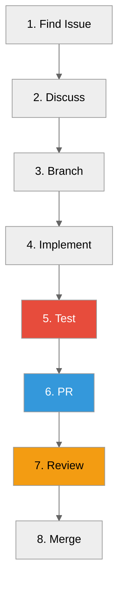

# Contributing Guide

**How to contribute to ProximaDB**



---

## Getting Started

### Prerequisites

- **Rust**: 1.88+ (`rustup --version`)
- **Python**: 3.11+ (for SDK tests)
- **Docker** (optional): For containerized testing
- **Git**: For version control

### Initial Setup

```bash
# 1. Fork and clone
git clone https://github.com/YOUR_USERNAME/proximadb.git
cd proximadb

# 2. Add upstream remote
git remote add upstream https://github.com/anvai-labs/proximaDB.git

# 3. Install development tools
cargo install cargo-watch cargo-nextest
cargo install cargo-tarpaulin
cargo install cargo-edit

# 4. Verify setup
cargo build
cargo test
```

---

## Development Workflow

Every change follows the same loop. The roadmap's release exit criteria are executable because
of it (ADR-096 D5).

### 1. Pick work from the plan

Take work from the current release in the
[roadmap](../current/ROADMAP.adoc), through its TD. A new design decision is
an ADR and a new piece of work is a TD file; follow the
[filing convention](../12-design/HOW_TO_FILE_TD_AND_ADR.adoc). Check open PRs first; many
sessions work in parallel.

### 2. Isolate it

```bash
eval "$(scripts/worktree.sh new fix/<topic>)"   # one worktree + branch off origin/develop
scripts/worktree.sh guard                       # fails if you are in the shared checkout
```

Never edit, stash or reset in the shared checkout or another worktree.

### 3. Write the failing test first

* Reproduce the defect, or specify the behaviour, as a test that fails on `origin/develop`, and
  confirm it fails for the expected reason.
* Test through ports and wire protocols, not internal module paths. Every test uses its own
  temporary directory, with storage, catalog and WAL anchored inside it.
* For a read-path change, assert the durable effect across surfaces (SQL, REST, gRPC, by-key and
  scan) and include delete-then-reinsert and update-then-flush.

### 4. Make it pass, then smoke it end to end

* Durability or wire-protocol work also gets an end-to-end smoke: pgwire e2e suites, crash
  matrices, or `scripts/smoke_oltp_reattach_minio.sh` against MinIO for object storage and volume
  reattach.
* Storage-format changes are mixed-read-safe, version-marked and default-off until their
  round-trip and recall gates pass.

### 5. Verify locally the way CI does

```bash
cargo fmt --check
cargo clippy --lib --bins -- -D warnings
cargo nextest run -p proximadb <filters>      # RUST_MIN_STACK=16777216 for pgwire e2e
make work-commit-check                        # docs, guards, contracts
```

A change that makes an authority document wrong fixes it in the same PR: support contract,
roadmap, TD status, diagrams.

### 6. Adversarial review before push

Commit locally, then have a fresh-context reviewer attack the commit: callers and blast radius,
invariants, test quality, and every claim in the docs and commit message. Fix or disprove each
finding by running it, then review the delta again. CI should run once, on reviewed code.

### 7. Open one coherent PR

Batch related work into one medium-to-large PR: feature, tests and docs together. Commit and PR
text carries no AI attribution (`scripts/check_no_agent_attribution.py`). Merge once CI passes;
`develop` requires `CI Success`.

---

## Coding Standards

### Style

```bash
# Format code
cargo fmt --all

# Check format
cargo fmt --all -- --check
```

**Style Guidelines:**
- 4 spaces (no tabs)
- Max 100 characters per line
- Trailing commas in multi-line arrays
- Meaningful variable names

### Linting

```bash
# Run clippy
cargo clippy -- -D warnings

# Fix automatically
cargo clippy --fix --allow-dirty --allow-staged
```

**Common Warnings to Fix:**
- Unused variables
- Dead code
- `unwrap()` in production code
- Missing error handling

### Documentation

```rust
/// Public function documentation.
///
/// More detailed explanation here.
///
/// # Arguments
///
/// * `arg1` - Description
/// * `arg2` - Description
///
/// # Returns
///
/// Description of return value
///
/// # Examples
///
/// ```
/// use proximadb::function;
/// let result = function(arg1, arg2);
/// assert_eq!(result, expected);
/// ```
///
/// # Errors
///
/// Returns error if...
pub fn function(arg1: Type1, arg2: Type2) -> Result<Output, Error> {
    // ...
}
```

---

## Testing Standards

### Test Organization

```rust
// In src/module.rs
#[cfg(test)]
mod tests {
    use super::*;

    #[test]
    fn test_basic_case() {
        // Arrange
        let input = ...;

        // Act
        let result = function(input);

        // Assert
        assert_eq!(result, expected);
    }

    #[test]
    fn test_error_case() {
        let result = function(bad_input);
        assert!(result.is_err());
    }
}
```

### Test Coverage

```bash
# Generate coverage
cargo llvm-cov --lib --html --output-dir coverage

# Check percentage
cargo llvm-cov --lib --summary
```

**Target:** 60%+ coverage for new code

### Integration Tests

```rust
// tests/integration_test.rs
use proximadb::ProximaDB;

#[tokio::test]
async fn test_collection_crud() {
    let server = ProximaDB::start_test().await.unwrap();
    let client = server.client();

    // Test create
    let collection = client.create_collection("test", 128).await.unwrap();
    assert_eq!(collection.name(), "test");

    // Test insert
    collection.insert(...).await.unwrap();

    // Test search
    let results = collection.search(...).await.unwrap();
    assert!(!results.is_empty());
}
```

---

## Common Tasks

### Adding a New Storage Engine

1. Create `src/storage/engines/impls/myengine/mod.rs`
2. Implement `UnifiedStorageEngine` trait
3. Register in `src/storage/engines/factory.rs`
4. Add tests in `tests/myengine_integration_test.rs`
5. Update documentation

### Adding a New API Endpoint

1. Update `proto/proximadb.proto`
2. Run `cargo build` (regenerates types)
3. Implement handler in `src/api_handlers/`
4. Add tests
5. Update API documentation

### Adding a New Graph Engine

1. Create `src/graph/engines/myengine/mod.rs`
2. Implement graph traits
3. Register in graph factory
4. Add integration tests
5. Update docs

---

## Pull Request Checklist

Before submitting PR, verify:

- [ ] Code follows style guidelines (`cargo fmt`)
- [ ] No clippy warnings (`cargo clippy`)
- [ ] Tests added/updated
- [ ] All tests pass (`cargo test --features test-full`)
- [ ] Documentation updated
- [ ] Commit messages are clear
- [ ] PR description references issues

### PR Description Template

```markdown
## Description
Brief description of the change

## Type
- [ ] Bug fix
- [ ] Feature
- [ ] Performance improvement
- [ ] Refactoring
- [ ] Documentation

## Changes Made
- Bullet point 1
- Bullet point 2

## Testing
- [ ] Unit tests added
- [ ] Integration tests added
- [ ] Manual testing completed
- [ ] Test commands: `cargo test ...`

## Breaking Changes
- [ ] None
- [ ] Yes (describe)

## Checklist
- [ ] Documentation updated
- [ ] Tests pass
- [ ] No merge conflicts

## Related Issues
Fixes #123
Related to #456
```

---

## Troubleshooting

### Build Errors

**Rust version mismatch:**
```bash
rustup update stable
rustup default stable
```

**Dependency conflicts:**
```bash
cargo clean
cargo update
cargo build
```

### Test Failures

**Port already in use:**
```bash
lsof -i :5678
kill -9 <PID>
```

**Test isolation issues:**
```bash
# Run tests sequentially
cargo test -- --test-threads=1
```

### CI Failures

**Check CI logs:**
- Compare with local output
- Check environment differences
- Verify Rust version

---

## Community Guidelines

### Be Respectful

- Use inclusive language
- Assume good intentions
- Give constructive feedback

### Communication

- Ask questions in Discussions
- Report bugs in Issues
- Join design conversations

### Recognition

Contributors recognized in:
- Release notes
- CONTRIBUTORS file
- GitHub contribution graph

---

## Resources

### Documentation

- CLAUDE.md - Project instructions
- [Architecture](../05-concepts/) - Technical concepts
- [Design Patterns](../12-design/DESIGN_PATTERNS.adoc) - Code patterns

### Tools

- [Rust Book](https://doc.rust-lang.org/book/)
- [Cargo Guide](https://doc.rust-lang.org/cargo/)
- [Tokio Guide](https://tokio.rs/tokio/tutorial)

### Community

- [GitHub Issues](https://github.com/anvai-labs/proximaDB/issues)
- [GitHub Discussions](https://github.com/anvai-labs/proximaDB/discussions)

---

## Need Help?

1. **Quick questions**: Ask in Discussions
2. **Bug reports**: Open an Issue
3. **Feature requests**: Open an Issue with RFC label

---

*Ready to contribute?* Start with [good first issue](https://github.com/anvai-labs/proximaDB/labels/good%20first%20issue)

*Thanks for contributing!* 🎉
