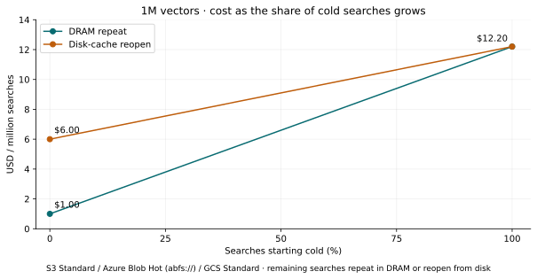
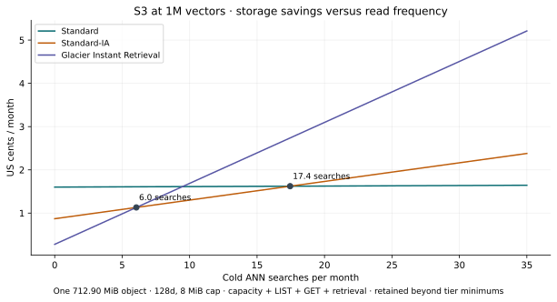

# PAX object I/O, recall and cost by cloud, tier and dimension

**For a small collection, reuse the complete object when it is already in hand.** In the 1K × 128 SIFT run the first ANN GET contained the entire 748,270-byte object. Two further GETs fetched 162,413 bytes from the same object. A single-object fast path could bring both forced ANN and eligible adaptive exact to one data GET after discovery. Under the current membership contract an independent cold process still needs a LIST. The proposed reader preserves each route’s scoring and snapshot visibility. [Design and acceptance tests](../../12-design/PAX_SPEC_THOUGHT_EXPERIMENTS_2026_10.adoc#small-object-cost) · [Measured operation and cost breakdown](PAX_SIFT_SCALE_REQUESTS_2026_11_22.adoc)

## How to read the figures

Figures 1–3 use the first ten queries on six prefixes of 128-dimensional TEXMEX SIFT, one compact PAX object per prefix, cold caches and an 8 MiB ANN merge setting. Recall@10 is overlap with the exact top ten for that prefix. Object IOPS is the mean number of HTTP object operations per search multiplied by **100 searches/second of assumed demand**. Each billed list page counts, and an HTTP range GET counts once. The benchmark ran serially. Sustained throughput, tail latency, real-cloud request counts, and disk-device IOPS require separate measurements. [Wire evidence, cache protocol and controls](PAX_SIFT_SCALE_REQUESTS_2026_11_22.adoc)

USD/M means **US dollars per million searches**. Unless a figure includes capacity explicitly, the bill covers modeled object GET/read, LIST, HEAD/properties and retrieval of the measured successful object response bodies. All measured query windows had zero HEADs, errors and writes. Prices assume same-region service, USD public on-demand rates on 2026-11-22, no billable network transfer, and no free allowance or negotiated discount. Compute, local cache media, unmeasured metadata bytes, catalog activity, storage capacity, minimum retention, replay/recovery and writes are separate budget items. The archived CSV breaks each profile into operation and retrieval columns. [Rates with meter identifiers](../../../bench_results/pax_sift_scale_20261122/request_rates.csv) · [All 144 query groups](../../../bench_results/pax_sift_scale_20261122/groups.csv)

| Profile | Modeled data tiers | Namespace and billing decision |
|---|---|---|
| AWS S3, us-east-1 | Standard, Standard-IA, Glacier Instant Retrieval | Each successful GET is one request. S3 prices LIST at the Standard PUT rate across data tiers. IA and Glacier Instant Retrieval add per-GB retrieval. |
| Azure Blob, eastus | Hot, Cool, Cold | General-purpose v2, flat namespace, LRS. Use a Hot listing/account profile with per-blob data tier. Get Blob is a read, List Blobs is a list operation, and Get Blob Properties uses the Other meter. |
| Azure DFS, eastus | Hot, Cool, Cold | ADLS Gen2 HNS, LRS. Model one Path List page per observed LIST using the Hot control profile. Estimate Path Read units per response as max(1, ceil(bytes / 4 MiB)). A Path Get Properties is one read. These are DFS projections. Proxima currently sends its abfs/adls aliases to the Blob endpoint. |
| Google Cloud Storage, us-central1 | Standard, Nearline, Coldline, Archive | Regional flat-namespace, Standard-default bucket with object-level tiers, Autoclass off. Object and metadata GETs are Class B. Bucket listing is Class A at the **bucket default** rate. A homogeneous Archive-default bucket adds $45 per million LISTs over this model. GCS Archive supports online reads. |

Use an endpoint-specific trace before adopting these prices. A DFS or ABFS client can split reads, prefetch or probe differently. For retrieval-priced data we apply the frozen rate to successful object body GiB (2³⁰ bytes). Blob LIST bodies and headers were unmetered in the capture. Different bucket/account defaults, encryption-key service calls, networking or restoration can add charges. S3 Glacier Flexible Retrieval/Deep Archive and Azure Archive require restores before the online read scenario. [AWS pricing](https://aws.amazon.com/s3/pricing/) · [Azure Blob rates](https://azure.microsoft.com/en-us/pricing/details/storage/blobs/) · [DFS rates](https://azure.microsoft.com/en-us/pricing/details/storage/data-lake/) · [Azure operation categories](https://learn.microsoft.com/en-us/azure/storage/blobs/map-rest-apis-transaction-categories) · [Google Cloud Storage pricing](https://cloud.google.com/storage/pricing)

## 1. Object IOPS versus accuracy


At 1M the ANN point is 0.980 recall and 1,900 projected object IOPS, comprising 18 GETs and one LIST per search. At 33K the same sampled recall requires 500 IOPS. The single-object exact controls coincide at 1.000 recall and 200 IOPS across sizes, although the object grows from 0.71 to 712.90 MiB. These points compare corpus sizes. A quality tuning curve requires varying the candidate budget on the **same** corpus and a larger query sample.

## 2. Object IOPS and cost per tier at 1M


At the same assumed demand, 1,900 HTTP operations/s become 2,240 modeled DFS transaction units/s including the list. At hot rates the projected charge is $12.20/M on S3, flat Blob and GCS, versus $17.628/M on DFS. At S3 Standard-IA the 18 GETs cost $18/M, the LIST costs $5/M, and retrieval adds $408.11/M, totaling $431.11/M. On GCS Archive the same modeled work totals $2,945.55/M. Price list traffic independently and evaluate whether the actively queried data belongs on a retrieval-priced tier.

## 3. Cost versus corpus size by tier


Each line uses measured ranges at the six labeled points. The segments joining points support visual comparison only. At 10K, flat hot storage would charge $6.60/M for forced ANN with one LIST and four GETs, versus $5.40/M for forced exact with one LIST and one GET. At 1M, DFS Hot would charge $99.58/M for the exact whole body (179 read units plus one list), versus $17.628/M for forced ANN. Plan choice can reverse when the endpoint meters bytes in fixed increments.

## 4. Cost and IOPS versus dimension in 128d increments


For each observed corpus size N, start with its measured **physical file length** at 128d. Keep the measured non-scaling overhead fixed and add `N × (d − 128) × 41 / 8` bytes. The 41 bits are f32 + SQ8 + a 1-bit base per new coordinate. This holds row IDs, metadata, residual payload, training geometry and encoding overhead fixed as a thought experiment. Real writer output can grow differently. At 1K the modeled physical bytes are 0.71 MiB at 128d, 3.84 MiB at 768d and 7.60 MiB at 1536d. An additional 8 KiB of incompressible source material per row moves all three above 8 MiB.

Both plans perform an exact full scan of the modeled object. One does a single GET, the other covers the same bytes with contiguous, non-overlapping 8 MiB GETs, plus a final short GET where needed. Both issue one cold LIST. At 128d and 1M, those plans need **200 vs 9,100 projected object IOPS** at 100 searches/s. DFS charges the same read units for those two plans because the modeled windows align to its 4 MiB meter. The explicit 8 MiB chunking here is independent of the ANN merge cap. These large scans illustrate costs. A production memory scheduler can reject either plan. ANN geometry and recall at widths above 128d have not been measured. [All dimensions, clouds and tiers](../../../bench_results/pax_sift_scale_20261122/dimension_costs.csv)

## 5. Cost versus corpus size by dimension


The figure shows three representative billing behaviors. All twelve curves coincide at $5.40/M on S3 Standard because there is one LIST and one GET. DFS Hot rises in 4 MiB steps. GCS Coldline charges for data retrieved. Consult the companion CSV for all 13 profiles and both physical plans. An 8 MiB fast path should compare the **sum of eligible physical bytes, file count, existing local coverage and applicable meter**. Dimensionality alone cannot decide.

## 6. Cost of a process restart



At 1M and 8 MiB the DRAM repeat and disk-cache reopen both required 2.5 object GETs on average. Reopen also required a LIST, changing modeled S3 Standard cost from $1/M to $6/M. Treat persistent object bytes and proof of current membership as separate cache entries. The lines interpolate the measured states for an assumed workload mix. Actual repeat frequency and working-set overlap determine how often each state occurs.

## 7. When a manifest head would pay for its writes


A hypothetical authoritative head that replaces one LIST with one GET saves $4.60/M cold discoveries at S3 Standard rates. One extra PUT per publish needs more than 1.09 cold discoveries per publish to pay back. Two extra PUTs need more than 2.17. Cached discoveries save nothing here. Measure the workload ratio and publication overhead before changing authority. Current ADR-098 keeps LIST authoritative. [Design and publication constraints](../../12-design/PAX_SPEC_THOUGHT_EXPERIMENTS_2026_10.adoc#small-object-cost)

## 8. When storage savings disappear



The fixture occupies 0.696 GiB. At first-band us-east-1 rates, Standard-IA saves roughly $0.0073/month of capacity against Standard. Its incremental cold query cost is about $0.000419. For this one long-lived, single-segment corpus, Glacier Instant Retrieval is cheapest below roughly **6 cold searches/month**, Standard-IA between about **6 and 17**, and Standard above about **17.5**. The example assumes the object already satisfies the 30/90-day retention minimums and its storage class stays fixed. Short-lived compaction outputs, transitions, caches and different retrieval volume change the answer. Place historical and active objects using their own read frequency and lifetime. [Capacity rates and minimums](../../../bench_results/pax_sift_scale_20261122/s3_capacity_rates.csv) · [AWS regional rates](https://pricing.us-east-1.amazonaws.com/offers/v1.0/aws/AmazonS3/current/us-east-1/index.json)

## Reproduce

From the repository root, the reporter verifies the archived access windows and computes the operation components. The plot script uses Matplotlib, writes eight SVGs and regenerates the dimension CSV.

```bash
d=bench_results/pax_sift_scale_20261122
python3 scripts/bench/pax_scale_wire_report.py "$d/queries.jsonl.gz" "$d/access.txt.gz" --csv > /tmp/pax-groups.csv
cmp "$d/groups.csv" /tmp/pax-groups.csv
python3 scripts/bench/plot_pax_scale_economics.py --groups /tmp/pax-groups.csv
```
