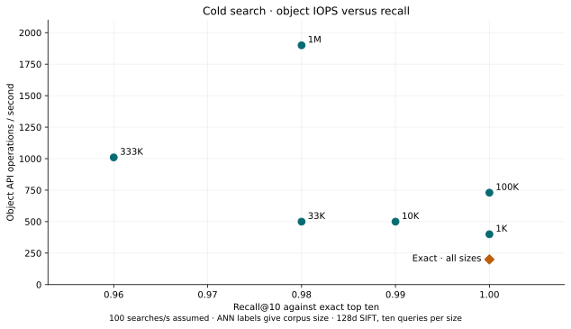
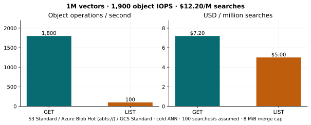
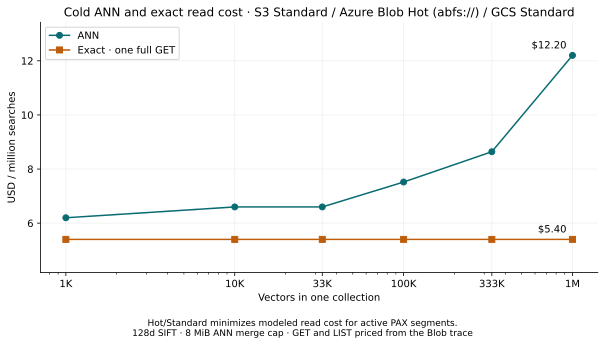
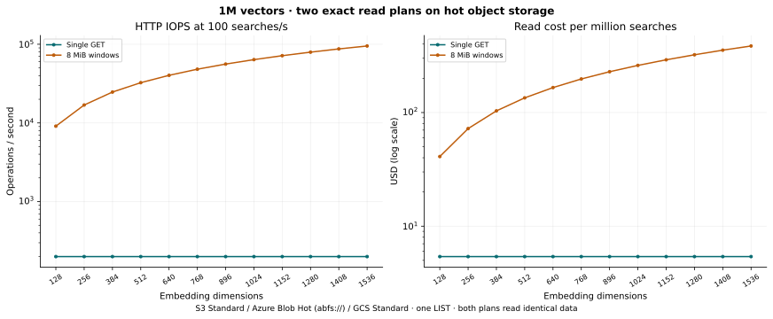
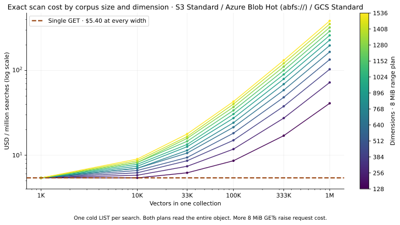
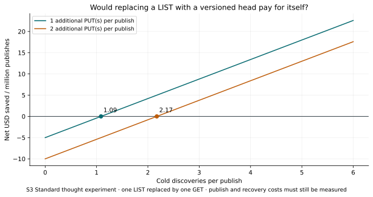

# PAX search economics on hot object storage

**Use hot storage for actively searched PAX segments.** PAX reads selected ranges and can issue several GETs per search. Hot and Standard have the lowest modeled read cost in each provider’s compared online tiers and charge no per-GiB retrieval fee in these profiles. On the measured 1M-vector cold ANN pattern, S3 Standard costs **$12.20 per million searches**, compared with **$431.11 on Standard-IA**. Total monthly cost also depends on capacity and how often queries reach object storage. For this long-lived S3 fixture, Standard becomes cheapest at about **18 cold searches per month**. [Placement calculation](#8-when-s3-standard-pays-for-itself) · [Archived rates for all tiers](../../../bench_results/pax_sift_scale_20261122/request_rates.csv)

**For a small collection, reuse the complete object when it is already in hand.** For query zero in the 1K × 128 SIFT run the first ANN GET contained the entire 748,270-byte object. Two further GETs fetched 162,413 bytes from the same object. A single-object fast path could bring both forced ANN and eligible adaptive exact to one data GET after discovery. Under the current membership contract an independent cold process still needs a LIST. The proposed reader preserves each route’s scoring and snapshot visibility. [Design and acceptance tests](../../12-design/PAX_SPEC_THOUGHT_EXPERIMENTS_2026_10.adoc#small-object-cost) · [Measured operation and cost breakdown](PAX_SIFT_SCALE_REQUESTS_2026_11_22.adoc)

## How to read the figures

Figures 1–3 use the first ten queries on six prefixes of 128-dimensional TEXMEX SIFT, one compact PAX object per prefix, cold caches and an 8 MiB ANN merge setting. Recall@10 is overlap with the exact top ten for that prefix. Object IOPS is the mean number of HTTP object operations per search multiplied by **100 searches/second of assumed demand**. Each billed list page counts, and an HTTP range GET counts once. The benchmark ran serially. Sustained throughput, tail latency, real-cloud request counts, and disk-device IOPS require separate measurements. [Wire evidence, cache protocol and controls](PAX_SIFT_SCALE_REQUESTS_2026_11_22.adoc)

USD/M means **US dollars per million searches**. Unless a figure includes capacity explicitly, the bill covers modeled object GET/read, LIST, HEAD/properties and retrieval of the measured successful object response bodies. All measured query windows had zero HEADs, errors and writes. Prices assume same-region service, USD public on-demand rates on 2026-11-22, no billable network transfer, and no free allowance or negotiated discount. Compute, local cache media, unmeasured metadata bytes, catalog activity, storage capacity, minimum retention, replay/recovery and writes are separate budget items. The archived CSV breaks each profile into operation and retrieval columns. [Rates with meter identifiers](../../../bench_results/pax_sift_scale_20261122/request_rates.csv) · [All 144 query groups](../../../bench_results/pax_sift_scale_20261122/groups.csv)

| Active-serving profile | Region and billing assumption |
|---|---|
| S3 Standard | us-east-1. Each GET is one read request. One list page is one LIST. |
| Azure Blob Hot | eastus, LRS, flat namespace. Get Blob, List Blobs and Get Blob Properties have separate transaction categories. |
| GCS Standard | us-central1, regional flat namespace, Standard-default bucket, Autoclass off. Object and metadata GETs are Class B. Listing is Class A. |

Proxima routes its Azure aliases `az://`, `azure://`, `adls://` and `abfs://` through the Blob endpoint. Its Google backend uses `gs://` or `gcs://`. Coldline is a GCS storage class for infrequent reads. The figures group endpoints where the frozen prices yield identical values. A different region, endpoint, cache mix or transfer path can change the comparison. Provider rates and the original multi-tier model remain available for repricing. [AWS rates](https://aws.amazon.com/s3/pricing/) · [Azure Blob rates](https://azure.microsoft.com/en-us/pricing/details/storage/blobs/) · [Azure backend](../../../src/storage/persistence/filesystem/azure_blob.rs) · [GCS storage classes](https://cloud.google.com/storage/docs/storage-classes) · [Google Cloud Storage rates](https://cloud.google.com/storage/pricing)

## 1. Object IOPS versus accuracy



At 1M the ANN point is 0.980 recall and 1,900 projected object IOPS, comprising 18 GETs and one LIST per search. At 33K the same sampled recall requires 500 IOPS. The single-object exact controls coincide at 1.000 recall and 200 IOPS across sizes, although the object grows from 0.71 to 712.90 MiB. These points compare corpus sizes. A quality tuning curve requires varying the candidate budget on the **same** corpus and a larger query sample.

## 2. Object IOPS and cost on hot storage at 1M



At 100 searches/s the 1M-vector workload requires 1,800 GETs/s and 100 LISTs/s. GETs cost $7.20 and LISTs cost $5.00 per million searches on each of the three serving profiles, totaling **$12.20/M**.

## 3. Hot storage cost versus corpus size



Each line uses measured ranges at the six labeled points. The segments joining points support visual comparison only. At 10K, flat hot storage would charge $6.60/M for forced ANN with one LIST and four GETs, versus $5.40/M for forced exact with one LIST and one GET. At 1M, exact still costs $5.40/M in requests but reads the full 712.90 MiB object. ANN fetches selected ranges. Latency, bandwidth and compute determine whether the lower-request plan can meet the service objective.

## 4. Cost and IOPS versus dimension in 128d increments



For each observed corpus size N, start with its measured **physical file length** at 128d. Keep the measured non-scaling overhead fixed and add `N × (d − 128) × 41 / 8` bytes. The 41 bits are f32 + SQ8 + a 1-bit base per new coordinate. This holds row IDs, metadata, residual payload, training geometry and encoding overhead fixed as a thought experiment. Real writer output can grow differently. At 1K the modeled physical bytes are 0.71 MiB at 128d, 3.84 MiB at 768d and 7.60 MiB at 1536d. An additional 8 KiB of incompressible source material per row moves all three above 8 MiB.

Both plans perform an exact full scan of the modeled object. One does a single GET, the other covers the same bytes with contiguous, non-overlapping 8 MiB GETs, plus a final short GET where needed. Both issue one cold LIST. At 128d and 1M, those plans need **200 vs 9,100 projected object IOPS** at 100 searches/s. The explicit 8 MiB chunking here is independent of the ANN merge cap. These large scans illustrate costs. A production memory scheduler can reject either plan. ANN geometry and recall at widths above 128d have not been measured. [All dimensions, clouds and tiers](../../../bench_results/pax_sift_scale_20261122/dimension_costs.csv)

## 5. Cost versus corpus size by dimension



Read the dashed line as a whole-object GET plus one LIST. That costs $5.40/M at all widths on the three hot serving profiles. Each colored curve reads exactly the same object in contiguous 8 MiB requests. At 1M × 128d, 90 GETs plus one LIST cost $41/M. At 1K all twelve modeled widths fit in one GET, so their points overlap. Consult the companion CSV for all 13 profiles and both physical plans. An 8 MiB fast path should compare the **sum of eligible physical bytes, file count, existing local coverage and applicable meter**. Dimensionality alone cannot decide.

## 6. Cost of a process restart


The horizontal axis is the share of searches starting cold. Choose a line according to how the *remaining* searches run. The DRAM line uses an immediate same-process repeat. The disk line uses the same query in a fresh process with a populated local disk cache. At 1M vectors both warm cases average 2.5 object GETs. The disk reopen also lists the collection to establish current membership. At the right edge every query starts cold, so both lines reach the same cost.

| Searches starting cold | Remaining searches | S3 Standard / Blob Hot / GCS Standard, USD/M |
|---:|---|---:|
| 0% | DRAM repeat / disk reopen | 1.00 / 6.00 |
| 50% | DRAM repeat / disk reopen | 6.60 / 9.10 |
| 100% | All cold | 12.20 |

For example, with half the queries cold and half reopening from disk, S3 costs `0.5 × $12.20 + 0.5 × $6.00 = $9.10` per million searches. Use measured production cache-state frequencies and reusable working sets when forecasting. The benchmark sampled immediate repeats of the same queries.

## 7. When a manifest head would pay for its writes



A hypothetical authoritative head that replaces one LIST with one GET saves $4.60/M cold discoveries at S3 Standard rates. One extra PUT per publish needs more than 1.09 cold discoveries per publish to pay back. Two extra PUTs need more than 2.17. Cached discoveries save nothing here. Measure the workload ratio and publication overhead before changing authority. Current ADR-098 keeps LIST authoritative. [Design and publication constraints](../../12-design/PAX_SPEC_THOUGHT_EXPERIMENTS_2026_10.adoc#small-object-cost)

## 8. When S3 Standard pays for itself


The fixture occupies 0.696 GiB. At first-band us-east-1 rates, Standard-IA saves roughly $0.0073/month of capacity against Standard. Its incremental cold query cost is about $0.000419. For this one long-lived, single-segment corpus, Glacier Instant Retrieval is cheapest below roughly **6 cold searches/month**, Standard-IA between about **6 and 17**, and Standard from approximately **18** cold searches/month. The example assumes the object already satisfies the 30/90-day retention minimums and its storage class stays fixed. Short-lived compaction outputs, transitions, caches and different retrieval volume change the answer. Place historical and active objects using their own read frequency and lifetime. [Capacity rates and minimums](../../../bench_results/pax_sift_scale_20261122/s3_capacity_rates.csv) · [AWS regional rates](https://pricing.us-east-1.amazonaws.com/offers/v1.0/aws/AmazonS3/current/us-east-1/index.json)

## Reproduce

From the repository root, the reporter verifies the archived access windows and computes the operation components. The plot script uses Matplotlib, writes eight SVGs and regenerates the dimension CSV.

```bash
d=bench_results/pax_sift_scale_20261122
python3 scripts/bench/pax_scale_wire_report.py "$d/queries.jsonl.gz" "$d/access.txt.gz" --csv > /tmp/pax-groups.csv
cmp "$d/groups.csv" /tmp/pax-groups.csv
python3 scripts/bench/plot_pax_scale_economics.py --groups /tmp/pax-groups.csv
```
