= PAX object reads from 1K to 1M SIFT vectors

These tables are the wire baseline before query-scoped whole-object reuse.
On the same 1K fixture the shipped reader reduced cold forced ANN and adaptive
exact from three data GETs to one. Each cold discovery still used one LIST.
link:PAX_QUERY_BODY_REUSE_2026_11_22.md[Measured reader changes and current defaults].

At 1K through 100K, widening the merge cap from 4 to 32 MiB saved zero
GETs on this SIFT fixture. At 333K and 1M, 8 MiB captured the entire
observed reduction. At 1M, the 4→8 change used 56,589 additional bytes
per cold search to save 0.3 GET, about 52.7 GiB more per million searches.
At 333K the same change added 92,718 bytes per query to save 0.1 GET.
All paired ANN top-ten sets and recalls survived the cap and cache changes.

Cold forced exact used one GET across the ladder. At 1K it was also faster
than cold ANN. At 10K the local median favored ANN (68 vs 96 ms), with
recall@10 0.990 vs 1.000 and four GETs vs one. The cold latency crossover
lies between those sampled sizes for this binary and those queries. The
cold GET-count crossover never occurred. Setting an exact guarantee,
selecting a latency target and minimizing the request bill lead to different
choices. A production cutoff needs a release build, real dimensions,
concurrency and the expected cache mix.

In the error-free 1M cold sample, applying AWS's illustrative S3 Standard
rates gives USD 12.32 per million forced ANN searches at 4 MiB (18.3
GETs and one LIST), USD 12.20 at 8 MiB and USD 5.40 for forced exact.
One avoidable LIST per cold query would save USD 5 per million at the same
rates. At 1M, exact fetched 712.90 MiB/search vs ANN's 41.74 MiB at 4 MiB.
Prioritize avoiding repeated discovery where immutable collection
membership can be validated. Compare physical plans at the required recall
and cap transient memory at the target concurrency before changing defaults.
link:https://aws.amazon.com/blogs/storage/run-spark-31-faster-and-optimize-compute-costs-with-amazon-s3-express-one-zone-on-amazon-emr/[AWS Standard GET, LIST and HEAD rate example].

== Wire cost per search

Mean object GETs per query across ten SIFT queries with exact ground truth at
each size. Exact issued one GET in each cache state. Both forced routes
issued one additional LIST cold, zero on the same-process repeat and one
after reopening. The per-size SIFT comparison uses the same objects for
all caps. The retained object also contains row data and all three
representations of the vectors. The USD column illustrates the 4 MiB ANN
GET-only fee per million searches, cold / L1 repeat / L2 reopen, at
USD 0.40 per million GETs and assuming identical S3 requests. The forced
exact route would be USD 0.40 in each state under the same assumption.

[cols="1,1,1,1,1,1,1,1",options="header"]
|===
| Vectors | Object MiB | Blocks / IVF cells | Exact cold GET | ANN cold GET at 4 MiB | ANN L1 / L2 GET at 4 MiB | ANN GET-only USD/M searches | ANN recall@10
| 1,000 | 0.71 | 2 / 2 | 1 | 3 | 1 / 1 | 1.20 / 0.40 / 0.40 | 1.000
| 10,000 | 7.08 | 2 / 2 | 1 | 4 | 1 / 1 | 1.60 / 0.40 / 0.40 | 0.990
| 33,000 | 23.42 | 3 / 2 | 1 | 4 | 1 / 1 | 1.60 / 0.40 / 0.40 | 0.980
| 100,000 | 71.03 | 8 / 7 | 1 | 6.3 | 1.4 / 1.4 | 2.52 / 0.56 / 0.56 | 1.000
| 333,000 | 237.18 | 29 / 24 | 1 | 9.2 | 1.8 / 1.8 | 3.68 / 0.72 / 0.72 | 0.960
| 1,000,000 | 712.90 | 90 / 72 | 1 | 18.3 | 2.6 / 2.6 | 7.32 / 1.04 / 1.04 | 0.980
|===

All five read caps appear below. Within each cell the figures are cold /
DRAM repeat / disk reopen GETs per query.

[cols="1,1,1,1,1,1",options="header"]
|===
| Vectors | 4 MiB | 8 MiB | 16 MiB | 24 MiB | 32 MiB
| 1,000 | 3 / 1 / 1 | 3 / 1 / 1 | 3 / 1 / 1 | 3 / 1 / 1 | 3 / 1 / 1
| 10,000 | 4 / 1 / 1 | 4 / 1 / 1 | 4 / 1 / 1 | 4 / 1 / 1 | 4 / 1 / 1
| 33,000 | 4 / 1 / 1 | 4 / 1 / 1 | 4 / 1 / 1 | 4 / 1 / 1 | 4 / 1 / 1
| 100,000 | 6.3 / 1.4 / 1.4 | 6.3 / 1.4 / 1.4 | 6.3 / 1.4 / 1.4 | 6.3 / 1.4 / 1.4 | 6.3 / 1.4 / 1.4
| 333,000 | 9.2 / 1.8 / 1.8 | 9.1 / 1.7 / 1.7 | 9.1 / 1.7 / 1.7 | 9.1 / 1.7 / 1.7 | 9.1 / 1.7 / 1.7
| 1,000,000 | 18.3 / 2.6 / 2.6 | 18 / 2.5 / 2.5 | 18 / 2.5 / 2.5 | 18 / 2.5 / 2.5 | 18 / 2.5 / 2.5
|===

The following cold reads use the 4 MiB cap. MiB counts successful object
response bodies. Times are medians on a single localhost emulator and an
unoptimized test binary. Use them to interpret this fixture. Use a release
build with production concurrency to set a latency or memory SLO.

[cols="1,1,1,1,1,1",options="header"]
|===
| Vectors | Exact MiB | ANN MiB | Exact ms | ANN ms | Warm ANN L1 hits / reopened L2 hits per query
| 1,000 | 0.71 | 0.87 | 12.2 | 50.5 | 1 / 1
| 10,000 | 7.08 | 1.92 | 96.4 | 68.3 | 1 / 1
| 33,000 | 23.42 | 3.96 | 340.9 | 105.6 | 1 / 1
| 100,000 | 71.03 | 15.87 | 1115.4 | 164.4 | 3.2 / 3.2
| 333,000 | 237.18 | 23.64 | 3793.4 | 216.9 | 7.3 / 7.3
| 1,000,000 | 712.90 | 41.74 | 12126.0 | 361.1 | 16.1 / 16.1
|===

== Per-operation request cost by endpoint

link:PAX_OBJECT_STORE_COST_ATLAS_2026_11_22.md[Eight figures: IOPS, recall, corpus size, 128d dimension increments, object tiers, caches and publish economics].

Cold forced ANN with an 8 MiB merge setting. Counts are means per search.
Prices are USD per million searches. Each price cell shows read + list = total.
HEAD and write charges here are zero. Both the cold and reopened process use
one list page. The DRAM repeat uses none. The CSV includes separate GET/read,
LIST, HEAD/properties and total cost columns for every route, cap and cache state.
The same HTTP request mix is replayed against three pricing profiles. Only the
Blob endpoint request counts were measured, on Azurite.

[cols="1,1,1,1,2,2,2",options="header"]
|===
| Vectors | Object GETs | LISTs | DFS read units | S3 Standard USD/M | Azure Blob Hot USD/M | ADLS DFS Hot USD/M
| 1,000 | 3 | 1 | 3 | 1.2 + 5 = 6.2 | 1.2 + 5 = 6.2 | 1.56 + 6.5 = 8.06
| 10,000 | 4 | 1 | 4 | 1.6 + 5 = 6.6 | 1.6 + 5 = 6.6 | 2.08 + 6.5 = 8.58
| 33,000 | 4 | 1 | 4 | 1.6 + 5 = 6.6 | 1.6 + 5 = 6.6 | 2.08 + 6.5 = 8.58
| 100,000 | 6.3 | 1 | 8.3 | 2.52 + 5 = 7.52 | 2.52 + 5 = 7.52 | 4.316 + 6.5 = 10.816
| 333,000 | 9.1 | 1 | 11.8 | 3.64 + 5 = 8.64 | 3.64 + 5 = 8.64 | 6.136 + 6.5 = 12.636
| 1,000,000 | 18 | 1 | 21.4 | 7.2 + 5 = 12.2 | 7.2 + 5 = 12.2 | 11.128 + 6.5 = 17.628
|===

The frozen 2026-11-22 USD rates are for S3 Standard in us-east-1, flat GPv2
Blob Hot LRS in eastus, and ADLS Gen2 Hot LRS with HNS through the DFS
endpoint in eastus. For one million successful operations the respective
read / list / properties rates are USD 0.40 / 5.00 / 0.40,
0.40 / 5.00 / 0.40 and 0.52 / 6.50 / 0.52. Blob properties use the
Other meter. DFS Path List uses Iterative Read. For a DFS read, round each
successful response length up to units of 4 MiB with a minimum of one, then
sum. Counting an entire 8 MiB response as one DFS read would underprice it.
The projection assumes the same ranges and pagination. An ABFS client can
change the mix through buffering, readahead, properties probes or retries.
Proxima’s current az/adls/abfs schemes all select its Blob endpoint adapter.
Choose the account namespace, tier and actual endpoint for pricing.
link:../../../src/storage/persistence/filesystem/mod.rs[Filesystem registration],
link:https://learn.microsoft.com/en-us/azure/storage/blobs/map-rest-apis-transaction-categories[Azure API-to-meter mapping] and
link:https://learn.microsoft.com/en-us/azure/storage/blobs/blob-storage-estimate-costs[Microsoft endpoint and read-unit rules].

The rate card stores AWS SKUs and Azure meter IDs from the public price
lists. The Azure filter is service Storage, armRegionName eastus, Consumption,
Hot LRS. These hot profiles cover successful query operations. The accompanying rate card also prices GCS and online retrieval tiers for all three clouds. The report
leaves dollar columns empty for a group containing an unpriced response.
Writes, compaction, catalog discovery outside the query window, storage,
local compute and cache costs belong in the workload-level calculation.
link:../../../bench_results/pax_sift_scale_20261122/request_rates.csv[Frozen rate card],
link:https://pricing.us-east-1.amazonaws.com/offers/v1.0/aws/AmazonS3/current/us-east-1/index.json[AWS regional price list],
link:https://learn.microsoft.com/en-us/rest/api/cost-management/retail-prices/azure-retail-prices[Azure Retail Prices API], and
link:../../../bench_results/pax_sift_scale_20261122/groups.csv[144 cost breakdowns].

For the small-object design and the interaction with discovery authority see
link:../../12-design/PAX_SPEC_THOUGHT_EXPERIMENTS_2026_10.adoc#small-object-cost[Small-object reads and collection discovery].

== Adaptive route selected

A fresh process ran query zero with each f32 budget at a fixed 4 MiB read
cap. Each entry names the observed route and gives its object GET count.
Each also issued one LIST. Cold routing reads segment facts before executing
the selected route, so a forced exact measurement understates the cost of a
cold adaptive exact query.

[cols="1,1,1,1,1,1,1",options="header"]
|===
| Vectors | Default (64 MiB) | 4 MiB | 8 MiB | 16 MiB | 24 MiB | 32 MiB
| 1,000 | exact 3 | exact 3 | exact 3 | exact 3 | exact 3 | exact 3
| 10,000 | exact 3 | ann 6 | exact 3 | exact 3 | exact 3 | exact 3
| 33,000 | exact 3 | ann 6 | ann 6 | ann 6 | exact 3 | exact 3
| 100,000 | exact 3 | ann 8 | ann 8 | ann 8 | ann 8 | ann 8
| 333,000 | ann 13 | ann 13 | ann 13 | ann 13 | ann 13 | ann 13
| 1,000,000 | ann 19 | ann 19 | ann 19 | ann 19 | ann 19 | ann 19
|===

All 1,116 query windows had identical application and HTTP counts for GET,
LIST, HEAD and successful object bytes, with zero HTTP errors and zero HEADs.
The largest 206 response at the 4 MiB setting was 10.59 MiB at 100K and
12.90 MiB at 1M. The setting constrains merges. See the range planner
discussion below for the memory implication.

== Measurement

Each size uses a prefix of TEXMEX SIFT1M (128d, Euclidean distance) and the
first ten queries. The fixture writer produces one immutable compacted PAX
object with a trained coarse directory, RaBitQ, SQ8, an explicitly enabled
authoritative f32 tier, row IDs and timestamps. There is no external payload,
predicate, compaction publish, collection-level coarse directory or concurrent
search in this fixture. The observed HTTP operations cover SST unified search
from collection discovery to ten IDs. They exclude ingestion, query markers and
service layers above the engine.

For each query and candidate range cap, the driver starts a process with empty
engine caches and an empty disk cache. It runs the same query again in that
process (L1 repeat), then reopens the disk cache in a fresh process (L2 reopen).
L1 means DRAM and L2 means the persistent byte store. Reopen also resets
process-local collection discovery. These states describe an isolated first
read and same-query reuse. Traffic from distinct users can have much less
overlap. The OS, emulator and TCP connection can already be warm.

The read-range sweep changes the PAX coalescing cap to 4, 8, 16, 24 or 32 MiB
on identical objects, at a fixed 1 MiB allowed gap. The writer uses Azure's
4 MiB target at every point. The forced exact path reads the entire object and
needs one cap control. A separate cold adaptive query varies the per-collection
*f32 scan budget* over the same five numbers and the default while leaving the
read cap at 4 MiB. The engine trace supplies the actual route, cache hits and
application bytes. A dedicated Azurite access log independently supplies full
and range GETs, successful object-response bytes, LISTs, HEADs and HTTP errors.
A range GET is one object GET. The ledger reports LIST separately even though
Azure sends it with the HTTP GET method.

== Interpreting 4, 8, 16, 24 and 32 MiB

The Azure I/O policy uses a 4 MiB target. The S3 policy uses an 8 MiB target, and its optional
read-plan chooser evaluates up to 16 MiB. The Azure chooser can evaluate up to
24 MiB, and this sweep uses an explicit override to include 32 MiB. A larger contiguous range can combine neighboring
extents in one object while leaving the logical candidates unchanged. It helps
when ranges would otherwise split or merge, and consumes more transient memory
when the reader has several large responses in flight. Gaps beyond the merge
limit and boundaries between objects still require separate requests. S3
GetObject accepts one byte range per call.
link:https://docs.aws.amazon.com/AmazonS3/latest/API/API_GetObject.html[S3 GetObject].

A 32 MiB read cap permits a 32 MiB response where combining ranges helps. It
does not pad a 200 KiB request to 32 MiB. At four full-size simultaneous
responses per query and eight simultaneous queries, the response bodies
alone could occupy 1 GiB, versus 128 MiB at 4 MiB. This is a capacity
example. An indivisible extent or a whole-region fallback can exceed the
merge cap, so this calculation supplies no memory bound. The CSV includes
the largest observed 206 response per group. A hard memory limit requires
admission on actual in-flight bytes. The sweep measured neither concurrent
peak memory nor S3 throughput.

Changing *writer block size* is a separate experiment. It can change cell
geometry, compression, I/O amplification for sparse lookups and the working
set of the caches. For that experiment, rewrite the same corpus at each
writer target and compare the same read caps, returned IDs, tail latency,
and peak memory at the target concurrency. A successful read-cap override
already works on existing files without a rewrite.

An earlier release-build BIGANN 1M × 128 study at recall@10 0.9800 measured
10.077, 8.177, 7.657 and 7.647 wire GETs/query at 4, 8, 16 and 24 MiB.
The 16→24 step saved 10,000 calls per million searches. The 4→16 step
saved 2.42 million. On a separate 491,655 × 768 fixture, 4→32 MiB cut
49.543 to 17.084 GETs/query at recall@10 0.9837 and raised peak RSS from
4.656 to 5.228 GB. The latter exceeded that study's 10% RSS allowance.
These release studies used different geometry and query populations from
the SIFT prefix sweep.
link:../../10-quality/td/TD-SEARCH-3-per-operation-read-coalescing.adoc[Release curves, conditions and acceptance gates].

For S3 Standard serving EC2 in the same AWS Region through a gateway endpoint,
S3 data transfer on this path and endpoint processing both cost zero.
At the AWS example price of USD 0.0004/1,000 GETs, a mean of G wire GETs/query
corresponds to USD 0.40 × G in GET charges per million searches *if S3 issues
the same requests*. One 32 MiB response and one 4 MiB response have equal
request charges. Price LISTs and other request classes separately and use the
deployment's regional rates. Retrieval-priced storage classes require an
additional byte term. Network capacity, decode CPU and memory consumption
still affect throughput and compute cost on S3 Standard.
link:https://aws.amazon.com/s3/pricing/[AWS S3 pricing] and
link:https://docs.aws.amazon.com/vpc/latest/privatelink/gateway-endpoints.html[VPC gateway endpoint pricing].

== Exact eligibility

For an eligible f32 collection, the observed baseline tests a nonzero row
count, the adaptive row ceiling (default 100,000), and
`rows × dimensions × 4 <= byte_budget` (default 64 MiB). A collection can
request its own byte budget or pin exact. A default-written f32 tier alone
does not opt an otherwise quantized collection into adaptive exact search.
The physical scan currently downloads the whole PAX file, including the
other retained tiers. Thus additional payload can make the actual read
substantially larger than the f32 estimate.
link:../../../src/storage/engines/sst/search/mod.rs[Adaptive and exact reader] and
link:../../../crates/foundation/proximadb-search-types/src/search_params.rs[Search mode defaults].

[cols="1,1,1,1",options="header"]
|===
| f32 budget | Max rows at 128d | At 768d | At 1536d
| 4 MiB | 8,192 | 1,365 | 682
| 8 MiB | 16,384 | 2,730 | 1,365
| 16 MiB | 32,768 | 5,461 | 2,730
| 24 MiB | 49,152 | 8,192 | 4,096
| 32 MiB | 65,536 | 10,922 | 5,461
|===

These are coordinate-budget boundaries. Ten thousand f32 vectors occupy
4.88 MiB at 128d and 29.30 MiB at 768d, before other tiers. Physical
blocks, IVF cells and object requests are separate units. Selecting
`sqrt(4) = 2` of four blocks offers no exactness guarantee. A guarantee
requires evaluating all eligible vectors or proving skipped vectors cannot
enter the top k. Even a quantized search that probes every cell can lose a
neighbor during scoring and candidate selection.

== Reproduction and audit

To remeasure the historical wire traffic, use a disposable worktree containing
the original reader and the archived benchmark harness. Use the three TEXMEX
files, a dedicated Azurite container and a shell with PAX tuning overrides unset. Configure
the Azure filesystem for that local emulator
and create the `pax-knee` blob container first. The measurement driver
writes objects below a unique prefix. Stop the disposable emulator after
saving its access log. These commands use the default six sizes, ten queries
and five caps of this ledger.

[source,bash]
----
trace_tree=$(mktemp -d)
git worktree add --detach "$trace_tree" f0c3b52bd5ff435f98a168b7375087fe36f68fb2
cd "$trace_tree"
git restore --source=e692c677a5c88b5449c4ea19aa00f86220b8fd61 -- \
  tests/sift_pax_recall_ratchet_test.rs tests/sift_pax_recall_ratchet_test/scale_cost.rs \
  scripts/bench/pax_scale_cost.py scripts/bench/pax_scale_wire_report.py \
  bench_results/pax_sift_scale_20261122/request_rates.csv
cargo test --locked --features azure,io-trace --test sift_pax_recall_ratchet_test --no-run
python3 scripts/bench/pax_scale_cost.py --binary "$SIFT_TEST_BINARY" \
  --dataset "$SIFT_DIR" --storage-url az://pax-knee/ann-scale \
  --wire-markers --output queries.jsonl
docker logs "$AZURITE_CONTAINER" > access.log 2>&1
python3 scripts/bench/pax_scale_wire_report.py queries.jsonl access.log --csv > groups.csv
----

Use the executable printed by Cargo for `SIFT_TEST_BINARY`.
The engine sources used in this run come from develop `f0c3b52bd`.
The host exposed 16 logical CPUs on an AMD Ryzen 9 7950X. Rust 1.100.0 built
the unoptimized test executable with debug symbols and incremental compilation
disabled. Its SHA-256 was
`814108244121c41b84e108c3a8e000ad3c0532b2ebf8759505fdd66a9005913a`.
The Azurite image ID was
`sha256:c26024d62bf4a5b88a40968afd217234c00e1fc9a4790dc6105d1ca7979f6eec`.
Base, query and ground-truth file SHA-256 digests respectively were
`21f66e2975057b5728ba56de1c825bac4f4d89d596609ae985741c6242631816`,
`f7fc9be140accdfd64116c2fa2365ecdb69b8f084970c6b0532db5ff79ac8fdc`
and `2b71de0a8d5a83e6a84eec3e23fb8b611d8801dd9b3a6cd62f070ab65ea65f4f`.

The test obtains ground truth by restricting supplied exact neighbors to the
prefix, falling back to an exhaustive search when fewer than ten survive.
It checks the forced route and the exact top-ten set. The report rejects
missing or duplicate matrix entries and incomplete marker windows. It
reports any difference between an ANN top-ten set and the same query's
cold 4 MiB result. Mean wire GETs include all attempts within each window.
`wire_partial_get` counts 206 responses within those GETs. `wire_object_bytes`
sums successful object response bodies and excludes HTTP headers and LIST
bodies. When converting attempts from other runs to dollars, apply the
provider’s billing rules for each response status. S3 excludes server errors
and certain other responses.
link:https://docs.aws.amazon.com/AmazonS3/latest/userguide/ErrorCodeBilling.html[S3 error billing].

The verifier also rejects unrelated traffic and wire counts or
bytes falling below their corresponding physical counters. The application counters use `get` and `bytes`. The survivor cache
uses `l1_hit` and `l1_miss`, with separate footer counters and shared L2
hit/miss counts. Exact search reads the entire object on each invocation
in this engine fixture.

link:../../../scripts/bench/pax_scale_cost.py[Measurement driver],
link:../../../tests/sift_pax_recall_ratchet_test/scale_cost.rs[Instrumented engine worker], and
link:../../../scripts/bench/pax_scale_wire_report.py[Wire reconciliation].

link:../../../bench_results/pax_sift_scale_20261122/groups.csv[All 144 measurement groups],
link:../../../bench_results/pax_sift_scale_20261122/queries.jsonl.gz[Raw query trace and fixture geometry], and
link:../../../bench_results/pax_sift_scale_20261122/access.txt.gz[Raw emulator access log].
